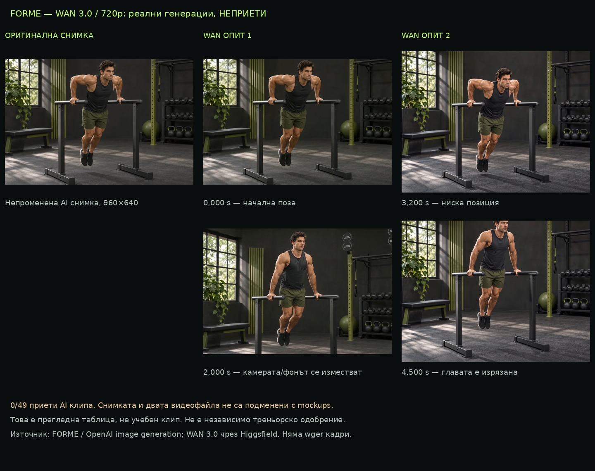

# AI видео подготовка — v0.14.2

**ЧАСТИЧНО ИЗПЪЛНЕНО.** Собственикът избра WAN 3.0/720p и спря генерациите. Двата получени WAN файла не са приети и не са в каталога, Service Worker или публичните медии. Старият реален 10,5 s MP4 остава непроменен, с правилното CC BY-SA авторство и без AI етикет.

## Шест стъпки за първия пример

1. Одит на main, снимката/позата/произхода и достъпните модели — извършен.
2. Генериране — два действителни WAN файла; няма готов/приет пример. По-ранният Seedance job завърши failed без файл; след избора на WAN не се използва друг модел.
3. Приемане — не е преминато. Първи WAN: 120/120 нормализирани кадъра прегледани, камерата следва тялото и кадрирането се измества. Втори WAN: отхвърлен на ранен последователен преглед за изрязване на главата/неубедително пълно повторение; не се твърди завършен 120-кадров преглед за него.
4. Компресия/маркери — процесът е проверен с първия неприет файл и отделен синтетичен QA образец. Това не променя отказа по качество.
5. Интерфейс — подготвени различни реален/AI произход, WAN/720p/internal-review gate и BG/EN/DE обозначение непосредствено под плеъра; проверяват се само със синтетични метаданни, без фалшива AI демонстрация в публичния каталог.
6. Регресии/main/Pages — проверките се изпълняват за подготвителната промяна. Статусът на Actions е отделно от приемането на клипа.

## Измерен материал и ограничения

Референция: `Parallel_Bar_Dips-960.webp`, 960×640, SHA-256 `cf4e32b81cf013b7d213f4c8415b7ce07e237f3da56c0788e2e7d36137eb326b`. Снимката има свити лакти и малко място над главата; запазена е без промени.

WAN опит 1: 5,000 s / 1174×782 / 30 fps / 150 кадъра, H.264/yuv420p, без аудио, 4 965 713 B. Нормализиране без crop/цветови филтър/ускоряване: 1080×720 / 24 fps / 120 кадъра. CRF23: 543 937 B / SSIM0,989486; CRF26: 359 761 B / 0,986386; CRF29: 248 203 B / 0,981713. SSIM спрямо обработения FFV1 с `settb=1/24,setpts=N`. Няма libvmaf; VMAF не е измерван. Всеки вариант запазва оригиналния AIGC JSON tag. **Всички остават неприети заради движението на камерата/кадрирането**, независимо от добрата компресия.

WAN опит 2: 5,000 s / 1108×832 / 30 fps / 150 кадъра, 3 931 630 B. Настройката е била 720p; действителният provider размер се отчита отделно. Ранно отхвърлен, не е оптимизиран/интегриран като готова демонстрация. Няма независимо треньорско приемане на двата файла.

Трети генерационен job **не е стартиран**: автоматичният преглед отказа нов разход след инструкцията за спиране, а собственикът изрично избра „Спри генерациите; публикувай проверената подготовка“. Няма автоматичен повторен опит, purchase, нов абонамент или фонова задача.



Подробни hash/параметри/статуси: [qa/ai-video-preparation.json](./qa/ai-video-preparation.json). Неприетите MP4 файлове остават извън публичното приложение.

## Възпроизводими проверки

```bash
node --test test.js *.test.js
python3 -m unittest discover -s qa -p 'test_video_policy.py'
python3 qa/video-audit.py
python3 qa/prepare-ai-video.py --input /path/to/original.mp4 --source-sha256 EXACT_SHA256 --output /tmp/forme-ai-review
```

Последната команда подготвя само прегледни варианти, отказва различен/непетсекунден източник и никога не одобрява клип автоматично. Unit проверката създава локален черен QA образец с изкуствен `LOCAL-QA-ONLY` AIGC tag; той не е упражнение/генерация и не се публикува.

Браузърният suite запазва действителните BG/EN/DE/24 viewport-theme/плеър/офлайн/cache-upgrade/guest/локални SDK проверки. Отделната AI fixture проверява само видимия преведен текст, позицията под плеъра и отказа на неодобрени метаданни. Тя не пуска неприетия клип и не удостоверява анатомия/реално AI възпроизвеждане.

Публична проверка: v0.14.2, същият стар MP4 и реален постер, без AI етикет върху реалния материал; Play/Pause/Replay/Seek/offline и запазени локални записи. Няма нужда собственикът да повтаря вече приетия тест за постоянно вписване. Не се твърди реален iPhone/Android видео тест; Chromium не ги замества.

Остават 48 упражнения без никакво видео и замяна на наличното първо; **0/49 приети AI клипа**. Фаза2/2.4 частична, общо13/20 основни задачи,7 незавършени+финално приемане. Няма срок за видеотеката по време на изрично поисканата пауза. [Стандарт](./FORME-EXERCISE-VIDEO-STYLE-GUIDE.md), [произход/прозрачност](./AI-VIDEO-PROVENANCE.md).
