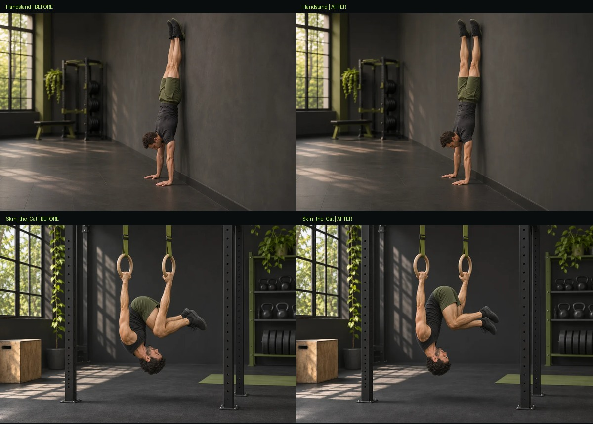
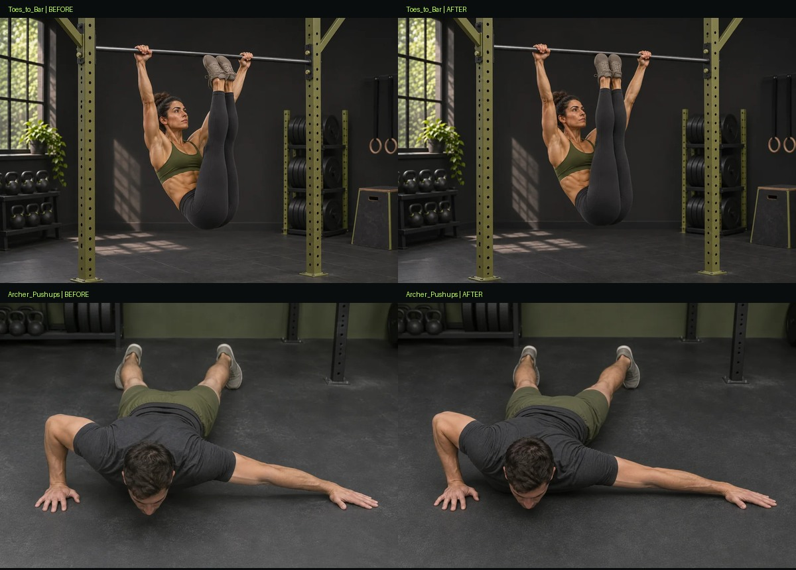
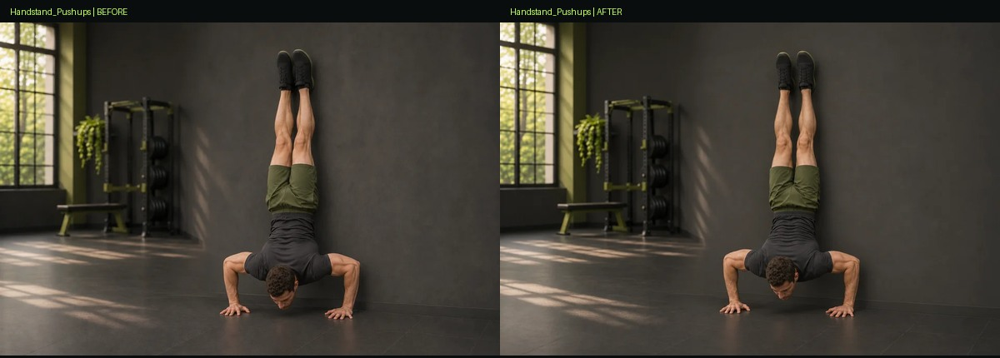

# FORME — пет корекции с Higgsfield / v0.16.2

**v0.16.4:** Handstand Push-Ups е пенсиониран от активния каталог и снимковите assets. [Текущ retirement и QA](./QA-EXERCISE-CLEANUP.md). Описанията на петте корекции по-долу са исторически.

**Актуализация v0.16.3:** трите Archer/Handstand/Skin изображения от този исторически цикъл са заменени по изричния избор на собственика. [Текущ избор и ограничения](./QA-EXERCISE-NANO-SELECTION.md). Toes to Bar и Handstand Push-Ups остават от v0.16.2.

Обхват: Фаза 1, задача 1.1; само Handstand, Skin the Cat, Toes to Bar, Archer Push-Ups и Handstand Push-Ups. База: `main` `334869904a54279a671f51a7e6c77f2ff9a0ce77` / v0.16.1. Останалите 44 exercise записа, храните, видеото, звукът, акаунтите и потребителските данни са запазени. Този цикъл не приключва цялата 1.1 или продукта: общият план остава 13/20 в определения обхват, 7 незавършени плюс общото финално приемане.

## Действителна генерация и визуален подбор

Използван е свързаният Higgsfield, модел **GPT Image 2.6** (`gpt_image_2_6`), референтно редактиране, quality `high`, PNG. За всеки кадър е подаден неговият действителен публичен 960px предшественик; проверените SHA-256, job ID, prompt и параметри са в [точния review receipt](./qa/exercise-image-review-v4.json). Това са действителни завършени генерации, а не подготвени prompts. Шест кандидата, пет избрани, един отхвърлен Skin the Cat. Общо 7,5 налични кредита; няма покупка, нов абонамент или видео генерация.

Сцената е заключена чрез собствената референция и отделни инструкции за архитектурата, прозореца, уредите, гледната точка, мащаба, палитрата, сенките и текстурите. Позата е описана отделно по реалните `name/level/equip/steps` от каталога. Моделът **няма exposed strength/adherence настройка**; не са измисляни стойности за такава. Подборът е по видим резултат. Фонът е максимално близък, а не обещан като пикселно идентичен: в две непрепокрити фонови области на кадър средната промяна на RGB канал е 0,78–8,59 от 255. Това е описателна проверка на цветовете, не доказателство за правилна анатомия.

| Упражнение | Предишен проблем / корекция |
| --- | --- |
| Handstand | Неясни припокрити глезени/обувки и линия на краката → два отделни контура на крака/стъпала, вертикална опора и логичен контакт на петите със стената. |
| Skin the Cat | Прекомерно сгънат торс/таз и припокрити подбедрици → по-отворен обърнат tuck transition, непрекъснат торс, две проследими свити колена, отделни подбедрици и обувки. Първият нов кандидат е отхвърлен за остатъчно компресиран торс. |
| Toes to Bar | Трудно четими крака и обувки около захвата → две разграничени линии от таза до обувките, два външни хвата и пръсти на височината на лоста. |
| Archer Push-Ups | Съмнителна геометрия около задните глезени/обувки → два проследими крака и отделни опорни стъпала; едната ръка сгъната, другата изпъната встрани. |
| Handstand Push-Ups | Неубедителни таз/бедра и припокриване на обувките → свързан вертикален таз/крака, отделни стъпала, сгънати лакти и глава над пода. |

Всеки избран кадър е разгледан в оригинал, с увеличени крайници/стави, като 960px WebP и като действителен 480px WebP. Прегледът проверява поотделно анатомия, точно упражнение, стил и собствен фон. Не е независима треньорска сертификация и не е автоматично откриване на крайници.

## Сравнения на действителните файлове

Вляво е предишният публичен WebP; вдясно е новият production WebP. Няма отделно преоцветяване на доказателствените кадри.

## Интеграция и проверка

Файлове: `media/exercises/<ID>-higgsfield-v4-{480,960}.webp`, 480×320 / 960×640, WebP quality85/method6 без EXIF/ICC, общо **262 048 B** вместо **277 800 B**. Четири raw изхода са 1024×688; отстранена е само периферията (1px вдясно, 3px отгоре и отдолу) до 1023×682, без промяна на тялото, цвета или светлината. Skin the Cat е native 1008×672. Компресията използва съществуващия guarded export helper след отделния визуален преглед.

Мапърът и манифестът сочат новите десет immutable URL. Старите десет файла са премахнати от актуалното дърво, историята остава. Service Worker `forme-mobile-v0162-higgsfield1` премахва само пенсионираните URL от медийния кеш; останалите снимки, видео, звук и локални записи се запазват. Снимките остават lazy и се кешират при разглеждане. Layout, 3:2 contain, липсата на overlay badge по v0.16.1 и съществуващото AI пояснение в alt/детайлите са запазени.

Publication gate за `higgsfield-v4` изисква точния SHA на предходната референция, Higgsfield/model/job provenance и отделни наблюдения за фон, композиция, цветове/осветление и материали. Предишните receipts са изрично маркирани като исторически за тези пет ID. Unit тестовете отказват липсващ или различен reference/job и отрицателно решение за фона; не могат сами да удостоверят правилна анатомия.

Повторяем браузърен тест: `FORME_CHROMIUM_EXECUTABLE=/usr/bin/chromium python3 qa/exercise-images-browser.py`. Той обхваща BG/EN/DE при 390/1280px, всички 49 карти и детайли, SHA/decode на десетте нови файла, 960px избор на десктоп, пълен кадър, офлайн повторно отваряне, премахване на стария кеш и запазени гост записи. Общите проверки са `node --test test.js *.test.js`, Python image/video gates, JS syntax и CI. Реалният им статус след изпълнение се отчита с конкретния commit; този документ не замества резултат от CI или физически телефон.

Финален собствен тест: отвори [Упражнения](https://ayorda.github.io/forme-fitness-app/#exercises), презареди онлайн, отвори петте детайла и сравни с листовете по-горе; след разглеждане повтори офлайн. Реален iPhone/Android визуален тест за тази версия не е проведен от средата. Видеата за останалите 48 упражнения остават отложени.

Локален резултат преди публикуване: **873/873 Node**, **13 image-gate + 16 video-policy Python**, **38 production JS parse** — успешно. Реалният Chromium тест премина шестте BG/EN/DE × 390/1280px случая, всички 49 детайла онлайн/офлайн, 10 SHA/decode проверки във всеки случай, без JS/CSP грешки, без production Firebase заявки; cache upgrade запазва госта и несвързаните медии. CSP/официалният SDK тест с локални Auth/Firestore емулатори премина guest/offline, отрицателните CSP проби, вход/архив/автоматична синхронизация/изтриване и възстановяване в трите езика. Това е браузърна проверка, не тест на физически телефон.
