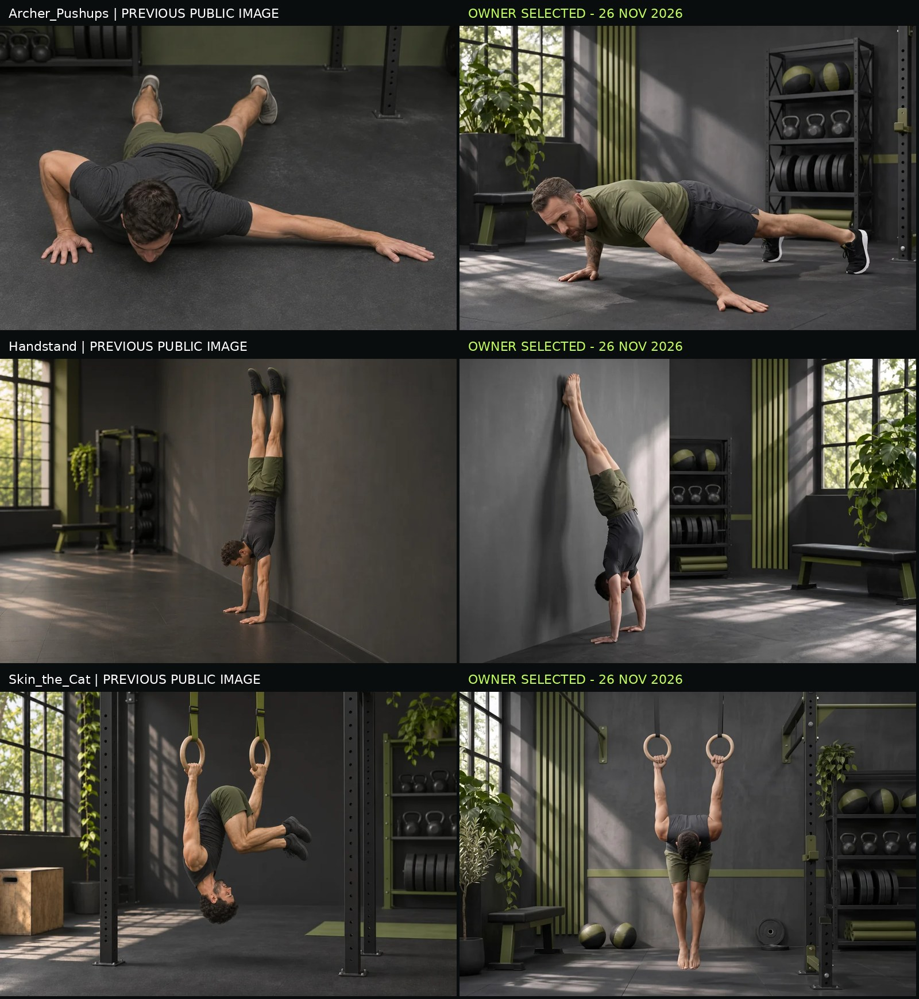

# FORME — три изображения, избрани от собственика · v0.16.3

На 26.11.2026 г. собственикът изрично избра трите показани thumbnails и поиска замяна и публикуване директно в `main`. Подменени са само **Archer Push-Ups**, **Handstand / Back-to-Wall** и **Skin the Cat**. Използвани са пълните оригинални генерации, а не screenshot-ът на галерията. Другите 46 exercise записа и всички храни са запазени.

## Избор и произход

| Упражнение | Съществуваща Higgsfield генерация | Наблюдения, запазени от прегледа |
| --- | --- | --- |
| Archer Push-Ups | `376e40ad-d7dd-4885-a2a8-e505a178feca` | Една сгъната натоварена ръка, друга изпъната встрани, два отделни крака и две обувки. Кандидатът има татуировка и е по-високо от най-ниската фаза на реалната референция; предишното строго отхвърляне за точно копие на позата не е превърнато в положителна оценка. |
| Handstand | `bdc68ac4-0e09-4698-a2be-9cc6aa8f4530` | Back-to-Wall, изпънати лакти и крака, стъпала до стената. Остатъчната извивка в кръста/таза спрямо по-правата референция остава описана; това не е сертифицирана идеална техника. |
| Skin the Cat | `151ef460-43dc-41df-964f-6b68fad491b3` | Избрана е фазата с краката надолу, наклонен торс и две отделни опори на халките, според подадената EX416 референция. Един кадър не демонстрира целия преход. |

Моделът е заявен като **Nano Banana Pro** (`nano_banana_pro`, 2K). Higgsfield отчита вътрешен job тип `nano_banana_2`; съответствието е документирано в [официалната CLI таблица](https://higgsfield.ai/blog/higgsfield-cli). Няма нови генерации, кредити или покупки в тази публикация. Генерираният материал остава под приложимите Higgsfield/model-provider условия; не се представя за реална фотография или одобрение от заснетите хора в референциите.

Точните raw/master/final SHA-256, job IDs, оригиналните pose-reference SHA, стиловите източници, предишните ограничения и изричният избор са в [receipt-а за избор](./qa/exercise-image-selection-v5.json). Това е `owner-selected` доставка, отделна от строгия автоматично проверяван receipt формат `accepted-visual`. Съществуващият `qa/prepare-exercise-image.py` и отрицателните му проверки не са разхлабвани. Изборът на собственика не е автоматична анатомична оценка или независима треньорска сертификация.

**Chest-to-Wall Handstand с обърнатите длани е изключен**. Не е заменено съществуващото Handstand Push-Ups изображение и не е създаден нов exercise ID.

## Реално сравнение

Ляво: предходен публичен файл. Дясно: избраният от собственика кандидат, компресиран до приложния размер. Частните оригинални pose снимки и raw генерации не се публикуват в хранилището.

## Файлове и кеш

Шест WebP файла: `media/exercises/{Archer_Pushups,Handstand,Skin_the_Cat}-nano-v5-{480,960}.webp`, съответно 480×320 и 960×640, общо **208 096 B**. Оригиналите са 2528×1696; отстранени са само 2 десни и 6 горни/6 долни периферни пиксела до точни 3:2, без разтягане или ретуш на тялото. WebP quality85/method6, без EXIF/ICC; изходните и двете крайни резолюции са прегледани.

Мапърът и медийният манифест сочат новите immutable адреси. Шестте предходни `higgsfield-v4` файла са пенсионирани и селективно премахвани от стария медиен кеш. Shell `forme-mobile-v0163-nano-selected1`, `exercise-photos.js?v=0163` и `interface-translations.js?v=0163` осигуряват обновяването; app/styles остават v0161. Другите снимки, музиката и видеото запазват кешовете си. Няма промени по акаунти, синхронизация, данни или layout.

## Повторяеми проверки

- `node --test test.js *.test.js`: общи функции, точни bindings/bytes, изборът на трите job IDs, изключеният Chest-to-Wall, запазени 46 exercise и всички food записи, обновяване на кеша.
- Python image gate / video policy и production JavaScript syntax проверките остават в CI.
- `FORME_CHROMIUM_EXECUTABLE=/usr/bin/chromium python3 qa/exercise-images-browser.py`: BG/EN/DE, 390/1280 px, всички 49 карти/детайла онлайн и офлайн, currentSrc, SHA/decode, 3:2 contain, стар кеш и гост записи. Това е браузърна емулация, не тест на физически телефон.

Точните резултати от local/CI/Pages се съобщават след изпълнението за конкретния commit. Страницата описва проверките и ограниченията, а не обещава успех на неизпълнен workflow.

Потвърден локален резултат за тази подготовка: **875/875 Node**, **13 image-gate + 16 video-policy Python**, **38 production JS parse**; шестте BG/EN/DE × 390/1280 браузърни случая минаха с всички49 детайла онлайн/офлайн, 10 current варианта SHA/decode, селективен upgrade и запазени гост записи. JS/CSP/production Firebase/пенсионирани медийни заявки: 0. Физически телефон не е тестван.
