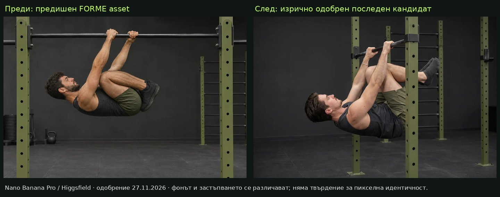

# FORME — одобрен Tuck Front Lever · v0.16.5

На 27.11.2026 собственикът одобри показания последен кандидат с „Супер се получи, публикувай директно в main“. Този release интегрира само него. Handstand Push-Ups остава пенсиониран; другите 47 упражнения, всички 30 храни, тренировките и потребителските данни са запазени.

## Избран оригинал и действителен модел

Higgsfield job `0afe6e3d-33e2-473b-b1ad-ffad5bc76600` е completed. Заявеният модел е **Google Nano Banana Pro** (`nano_banana_pro`), 2K, 3:2; вътрешният job type е `nano_banana_2`, описан като Pro в [официалната Higgsfield CLI таблица](https://higgsfield.ai/blog/higgsfield-cli). Изходът е PNG 2528×1696, 5 535 633 B, SHA-256 `646f6b1f6b8fe804fcbc1b39c2e163b8474cbe07f1c6930f9a45d7e8a1ba9d68`.

Реалната [позова фотография](https://calisthenics.com/front-lever-training-routine/) е основата за позата, ракурса и геометрията на лоста. Вторият вход е изрезка без човек от предходния FORME Tuck asset, координати `[670,130,960,640]`, само за палитра, материали и светлина. Предишни AI фигури не са използвани за поза в този последен опит. Точният prompt, SHA на референциите, оригинала, нормализирания изход и WebP файловете са в [receipt-а за избора](./qa/exercise-image-selection-v7.json). Raw файловете и реалната референция остават извън публичното хранилище.

Четирите по-ранни кандидата не са публикувани. Първите два са запазени в [историческия review](./qa/tuck-front-lever-review-v6.json); при третия собственикът прие само краката, а четвъртият беше отхвърлен за разположение спрямо лоста и ръце. Новото одобрение не пренаписва тези решения. Последният разрешен опит е изпълнен; за тази интеграция няма нова генерация, разход на кредити, покупка или абонамент.

## Визуален преглед и граници

- Ракурсът показва гърдите и двете ръце; лостът е в перспектива, а близката дясна стойка закрива част от таза/краката както в референцията.
- Двата затворени захвата са еднакво ориентирани. Ръцете се проследяват отделно; китките продължават естествено от предмишниците. Захватът изглежда съответстващ на ширината на раменете, без твърдение за точно 3D измерване.
- Краката са повдигнати и прибрани, стъпалата сочат нагоре. Различават се два контура на стъпала; части от таза и долните крайници са естествено закрити от стойката и не могат да бъдат напълно инспектирани.
- Графитната стена, черният под и приглушеният маслинен метал съответстват на FORME. Разположението на фона, дебелината на колоната, размерът на фигурата и застъпването се различават от стария asset и реалната фотография. Тези видими разлики бяха показани преди изричното одобрение.

Прегледани са изходът, увеличения на ръце/глезени и реалните 480/960 варианти. Това е визуална проверка и избор на собственика, а не автоматична анатомична проверка, идентичност по лице, 100% пикселно съвпадение или независима треньорска сертификация. Съществуващият строг publication helper не е отслабван; отделният receipt описва изричното одобрение.

## Файлове и обновяване

Извършен е само периферен crop — 1 px от всяка странична граница и 6 px от горната/долната — до 2526×1684, точно 3:2. Няма локална корекция на анатомия, фон или цветове.

| Файл | Размери | Bytes |
| --- | --- | ---: |
| `Tuck_Front_Lever-nano-v7-480.webp` | 480×320 | 10 792 |
| `Tuck_Front_Lever-nano-v7-960.webp` | 960×640 | 25 544 |

WebP quality 85 / method 6, без EXIF. Общо 36 336 B. `exercise-photos.js` и `media/manifest.json` сочат само към новите файлове. Двата предишни `Tuck_Front_Lever-anatomy-v3-{480,960}.webp` са премахнати и селективно изчиствани от медийния кеш при activation. Новите снимки се кешират след разглеждане, без масово precache.

Shell: `forme-mobile-v0165-nano-tuck1`; точни `exercise-photos.js?v=0165` и `interface-translations.js?v=0165` в HTML/SW. Непроменените app/data/skill-trees остават `?v=0164`, CSS `?v=0161`. Медийният, видео и аудио кешът са запазени. AI alt/дребният credit остават; не се връщат overlay badges.

## Проверки

Регресията свързва точно избрания job/raw/нормализиран SHA с активните WebP варианти, пази останалите 47 exercise и 30 food manifest записа и проверява пенсионираните URL. Съществуващият browser audit проверява всички 48 упражнения в BG/EN/DE при 390/1280 px, реално декодиране/SHA, онлайн/офлайн, cache upgrade, guest и legacy HSPU favorite/set/JSON export. Браузърната емулация не е физически iPhone/Android тест.

Локално потвърдено преди commit: **880/880 Node**, **14 image-gate + 16 video-policy Python**, **38 production JS parse** и audio/video audit. Browser: **6/6 BG/EN/DE ×390/1280**, всички 48 карти и детайли онлайн/офлайн, точни SHA/декодиране на 10 текущи заменени варианта, запазени guest/legacy HSPU favorite/set и действителен JSON download. Cache upgrade премахва пенсионираните снимки и пази несвързаните медии/данни. **0 JS/CSP/production Firebase/retired requests**. CI/Pages/public се проверяват отделно за действително публикувания commit; това локално доказателство не ги замества.

Общият продуктов статус остава 13/20 плюс 7 незавършени и общото приемане. Тази одобрена подмяна е в частичната задача 1.1, а не нова завършена основна задача.
