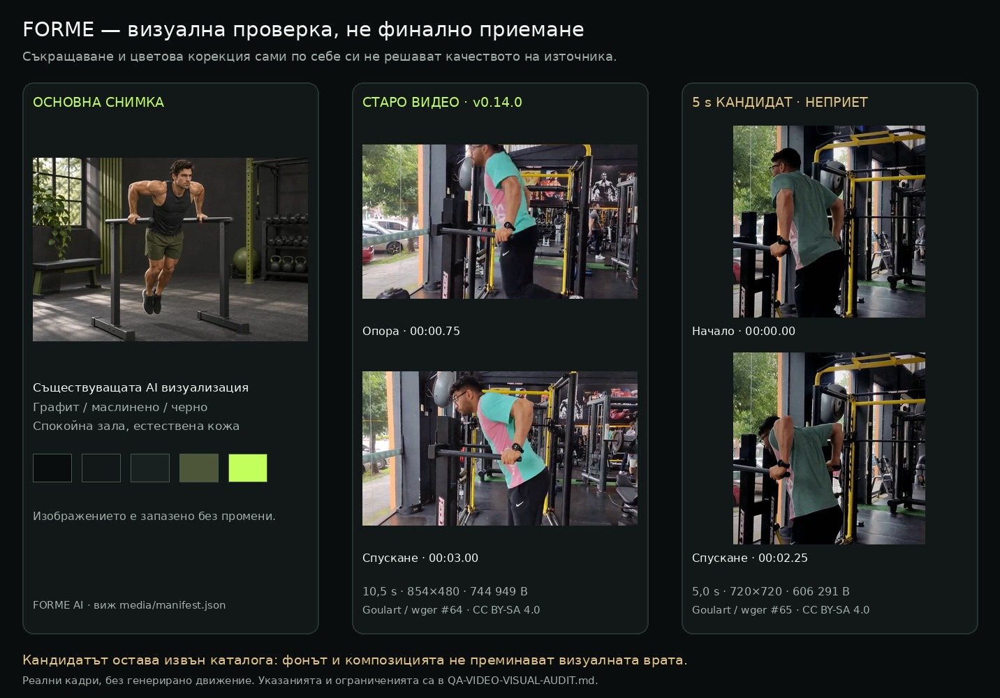

# Parallel Bar Dips — визуален одит, 16.11.2026

**Резултат: основната премиум поправка НЕ е завършена.** v0.14.1 доставя стандарт и техническа подготовка. Публичният клип остава старият 10,5 s материал. Пробният 5 s вариант е отхвърлен и не е регистриран в каталога или Service Worker. Няма основание да се представя като финален пример за останалите 48 упражнения.

## Реален визуален преглед

Проверени са main v0.14.0, двата WebP размера на Parallel Bar Dips, контактна таблица с всички 49 снимки, styles.css, манифестите, плеърът и кешът. Снимките имат графитен фон, черно/маслинено облекло, мека странична светлина и естествена кожа. Не са променяни.

Старото видео има ярка циан/розова тениска, жълта рамка, светъл прозорец с коли и много уреди. Главата излиза извън горната граница в част от движението. 10,5 s са излишни за целевата кратка демонстрация. AI снимката като предишен визуален преход не е действителен кадър от записа. По-къс клип и по-ниска наситеност не премахват тези проблеми.



Ляво: непроменената FORME AI визуализация, с произход в media/manifest.json. Среда: реални кадри от Goulart/wger видео 64 при 0,75/3 s. Дясно: реални кадри от пробната адаптация на Goulart/wger видео 65 при 0/2,25 s. Видеокадрите и адаптацията са [CC BY-SA 4.0](https://creativecommons.org/licenses/by-sa/4.0/); сравнението не променя лиценза на снимката. Няма генериране на движение/анатомия/фон. Панелите запазват собствените си пропорции.

## Източници и подбор

Публичните метаданни за [видео 64](https://wger.de/api/v2/video/64/), [видео 65](https://wger.de/api/v2/video/65/) и [лиценз №2](https://wger.de/api/v2/license/2/) са проверени отново. Автор: Goulart. Лиценз: CC BY-SA 4.0, **не** различният CC0 лиценз на текста за упражнението. Няма отделна предоставена декларация за образа или официално партньорство с FORME.

| Проверен кандидат | Причина да не бъде приет |
| --- | --- |
| wger 64, 65, 66 | Претрупан фон/ярки акценти; кадрирането и цветът не осигуряват убедително съответствие. |
| Pexels 34708347, 34568748, 34708295 | Силно синьо/жълто осветление, качулка/облекло скриват стави или прекалено тесен кадър. |
| Pexels 4367579 | По-близък неутрален фон, но видима верига/колан с неясно допълнително натоварване, частично скрити опори и бавно повторение около 7–8 s. Няма безопасно основание за непълно 5 s повторение или представяне като стандартни кофички без тежест. |
| Pexels 35585662 | Изрязани глава/китки, ярки жълти опори. |
| Pexels 8520403, 4804798, 4964658 | Различно движение: повдигане на крака/седящи кофички, не търсеното упражнение. |
| [Coverr: A Man Does Bar Dips](https://coverr.co/videos/a-man-does-bar-dips) | Реални кофички, но светъл външен терен/небе/оранжева рамка. Кадрирането не превръща материала в спокойна тъмна зала. Проверен е само безплатният FHD вариант, без Plus/4K покупка. |
| [Mixkit 735](https://mixkit.co/free-stock-video/man-doing-pull-ups-735/) | Подходяща черна тухлена зала, но упражнението е набиране. |
| Mixkit 23450, 23928 | Безплатният вариант е Restricted/лична употреба; не е подходящ за тази доставка. |

[Pexels](https://www.pexels.com/terms-of-service/) и [Coverr](https://coverr.co/license/) са прегледани за ограничения, търговска употреба и права на трети лица. Нито един техен материал не е включен в приложението/репозитория. Наличието на безплатно изтегляне само по себе си не решава правата за използване в библиотека с демонстрации.

## Пробна обработка — НЕПРИЕТА

Източник: [Goulart/wger 65 MOV](https://wger.de/media/exercise-video/194/7a6987aa-138d-41e4-8842-5c3e3d970bd9.MOV), 8 340 144 B, 1920×1080, 30000/1001 fps, 16,370068 s, H.264 с аудио. SHA-256: `70d306b3c036ffd7d0d2373d9c781442d996e710b490a1560381cb85b53917b3`.

Непрекъснат сегмент 11,3–16,3 s, без ускоряване/обръщане/интерполация. Crop 1080×1080 при x550/y0, мащаб 720×720, 24 fps. Индивидуална вторична HSL корекция намалява циан/розово/жълто, с лек контраст и баланс на сенките. Това **не е универсален LUT** за други източници. Кожата е прегледана визуално. Виждат се спускане и връщане в опора, но финалът включва завъртане, долната част на краката е изрязана и фонът продължава да конкурира атлета. Няма независимо треньорско удостоверяване.

| Пробен MP4, 5,000 s / 720×720 / 24 fps / 120 кадъра | Размер | SSIM |
| --- | ---: | ---: |
| H.264 CRF 23 | 955 445 B | 0,980721 |
| H.264 CRF 26 — избран за сравнение, НЕ за каталога | 606 291 B | 0,973858 |
| H.264 CRF 29 | 392 527 B | 0,964198 |

И трите: H.264 Main 3.1/yuv420p/faststart, без аудио и излишни метаданни. CRF 26 запазва повече детайл от най-малкия вариант; около 592 KiB. SSIM сравнява компресията с **вече изрязан/цветово обработен lossless FFV1**, не художественото съответствие със снимката. И двата входа са нормализирани с `settb=1/24,setpts=N`, за да няма разминаване на времевите бази. Инсталираният FFmpeg няма libvmaf; VMAF оценка не е измервана.

Възпроизводим процес (нужен е разрешеният оригинал със същия SHA):

```bash
python3 qa/prepare-video-study.py --input /path/to/original.MOV --output /tmp/forme-dips-study
```

Изходът остава извън производствената медийна директория. Скриптът отказва различен източник и никога не маркира резултата като приет. Подробните параметри/хешове са в [qa/video-style-study.json](./qa/video-style-study.json). Повторно изграждане даде идентични размери, SHA-256 и SSIM. Пробният клип не е публикуван като демонстрация.

## Доставена техническа подготовка

- Реален първи кадър от действащия стар MP4 като локален постер; снимката на упражнението остава над плеъра. Размерите запазват мястото и правилното съотношение.
- Native controls/Play/Pause/Replay/playsinline/preload none, без autoplay или звук. Указанията, резервната снимка и авторството остават.
- Отделен версиониран видео кеш, пренасяне на вече гледания пълен MP4 от стария кеш, запазване на снимките и офлайн резервно четене при недостиг на място. Нови версии използват нови URL/кеш; цялата библиотека не се изтегля при инсталиране.
- Неизползваният WebM (789 453 B, по-голям от активния MP4) е премахнат от текущата доставка; историята/хешът са запазени. Активният MP4 остава **точно 744 949 B / 10,5 s / 854×480 / 24 fps**, без промяна на байтовете.
- [FORME Exercise Video Style Guide v1.0](./FORME-EXERCISE-VIDEO-STYLE-GUIDE.md), автоматична проверка на манифеста и тесен, изричен `legacy-not-accepted` статус за стария хеш. Нова версия не може да наследи това изключение.

## Как се отключва финалният пример при бюджет 0 €

Нужен е собствен или изрично разрешен оригинал, който покрива едновременно движение, визия и права. Поискан е линк от собственика; отговорът е отделна зависимост. Практичен безплатен снимачен бриф: подредена графитена зала, неутрално черно/маслинено облекло, мека странична дневна светлина, неподвижна камера на 3/4 отстрани, всички ръце/опори/рамене/колене в кадър. Запишете няколко естествени повторения с неподвижна опора преди/след; предоставете оригинала, съгласието на участника и правото за използване/адаптация във FORME. Не снимайте други разпознаваеми посетители/марки без основание.

Следват отделно: подбор на пълно 5–6 s повторение или мотивирано изключение; независима техническа оценка; индивидуална цветова обработка; сравнение до съответната снимка; компресия/QA; реални iPhone Safari/Home Screen и Android тестове. Едва след визуално приемане започва разширяване към останалите 48 упражнения.

Напредък: Фаза 2 / 2.4 частична; 1/49 стари налични демонстрации, 48 без видео, **0/49 приети по новия премиум стандарт**. Общият план остава 13/20 основни задачи; 7 незавършени и общо финално приемане. Срок за целия продукт или окончателния видеопример не е потвърден без материал/права/оценка/устройства.
